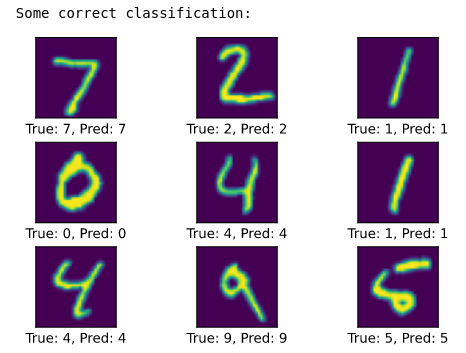
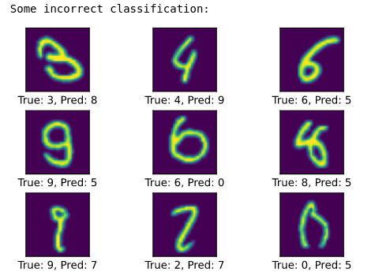

## Introducción

- **CNNumpy** es una Red Neuronal Convolucional escrita en Numpy puro (solo con fines educativos).
- Existen 2 versiones de implementación:
    - Slow (Lenta): La versión ingenua con bucles for anidados.
    - Fast (Rápida): La versión im2col/col2im.
- La [implementación lenta][slow-implementation] tarda alrededor de **4 horas por época**, mientras que la [implementación rápida][fast-implementation] tarda solo **6 min por época**.
- Para su información, con la misma arquitectura utilizando **Pytorch**, tardaría alrededor de **1 min por época**.
- **Para más detalles, aquí están mis publicaciones de blog explicando a fondo qué sucede internamente en cada implementación ([lenta][slow-blog] y [rápida][fast-blog]).**
- En el cuaderno [`demo-cnnumpy-fast.ipynb`][demo-notebook], la implementación im2col/col2im puede alcanzar una precisión de hasta el **97.2% en 1 época (~6 min)**. Aquí hay algunos resultados:





## Instalación

- Crea un entorno virtual en la carpeta raíz utilizando [virtualenv][virtualenv] y actívalo.

```bash
# En terminal de Linux, usando virtualenv.
virtualenv myenv
# Actívalo.
source myenv/bin/activate
```

- Instala **requirements.txt**.

```bash
pip install -r requirements.txt
# Limpia la carpeta raíz.
python3 setup.py clean
```

## Uso de los cuadernos de demostración (demo notebooks)

Para jugar con los archivos de `demo-notebooks/`, debes asegurarte de que jupyter notebook pueda seleccionar tu entorno virtual como kernel.

- Sigue primero las instrucciones de **"Instalación"** y asegúrate de que tu entorno virtual siga activado.
- Ejecuta la siguiente línea en la terminal.
```bash
python -m ipykernel install --user--name=myenv
```
- Ejecuta el archivo del cuaderno **únicamente desde `demo_notebooks/`** y luego selecciona **Kernel > Switch Kernel > myenv**. ¡Ya estás listo para comenzar!

<!---
Variables with links.
-->
[slow-implementation]: https://github.com/3outeille/CNNumpy/tree/master/src/slow
[fast-implementation]: https://github.com/3outeille/CNNumpy/tree/master/src/fast
[slow-blog]: https://hackmd.io/@machine-learning/blog-post-cnnumpy-slow
[fast-blog]: https://hackmd.io/@machine-learning/blog-post-cnnumpy-fast
[demo-notebook]: https://github.com/3outeille/CNNumpy/blob/master/src/demo_notebooks/demo-cnnumpy-fast.ipynb
[virtualenv]: https://packaging.python.org/guides/installing-using-pip-and-virtual-environments/
